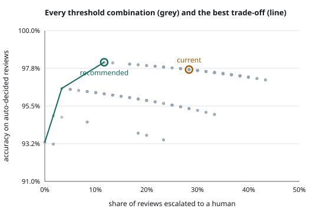

# Content Compliance Agent

A policy Q&A agent for a media compliance desk. You describe a piece of content, for
example "a telco advert uses an AI-cloned voice of a famous singer", or attach the
creative itself as an image, and it answers with
a verdict, the policy clauses the verdict rests on, and the changes that would make the
content compliant. Every answer carries three confidence signals. When any of them is
weak, the review goes to a human queue instead of being trusted.

- **Retrieval:** [LightRAG](https://github.com/HKUDS/LightRAG) in `mix` mode, which
  combines knowledge-graph traversal with vector search over the policy text.
- **Multimodal input:** attached images go through a vision pass first. What it sees
  (on-screen text, people, products, disclosure labels) becomes part of the retrieval
  query, and the judge then decides with the original image in front of it.
- **Decision:** Azure OpenAI with structured outputs (Pydantic).
- **Confidence:** token logprobs, semantic entropy across samples, and a groundedness
  check.
- **Interface:** served to [Open WebUI](https://github.com/open-webui/open-webui) as an
  OpenAI-compatible model.

> This is an independent prototype. The policy corpus in `policies/standards.yaml` is
> fictional sample text written for this repo. It is not any real broadcaster's or
> regulator's rules, and nothing here is legal advice.

## How a review works

```
images? ──► vision pass ──► observation (text, people, products, labels)
                                  │ appended to the scenario
                                  ▼
scenario ──► LightRAG (mix: KG entities/relations + chunk vectors)
                │  clause IDs recovered from each source's file path
                ▼
           top-5 clauses + graph facts
                │
      ┌─────────┼──────────────────────────┐
      ▼         ▼                          ▼
  decision   4 extra samples          (after decision)
  + images   + images                 grounding check:
  T=0, with  T=1
  logprobs                            split rationale into claims,
      │         │                     label scenario vs policy,
      │         │                     verify policy claims vs clauses
      ▼         ▼                          ▼
 verdict     agreement =              groundedness =
 probability 1 − H(verdicts)/log 3    supported policy claims / all
      └─────────┴──────────┬───────────────┘
                           ▼
            any signal under threshold? ──► human review queue (/review)
                           │ no                    ▲          │ approve / override
                           ▼                       │          ▼
                      auto-decided ── reported ────┘    eval cases (export-feedback)
```

| Signal | What it measures | Default threshold |
| --- | --- | --- |
| Verdict probability | exp of the summed logprobs of the verdict tokens the model emitted | ≥ 0.85 |
| Agreement | 1 − normalised entropy of verdicts over 5 samples. This is the discrete form of semantic entropy (Farquhar et al., *Nature* 2024): answers are clustered by meaning, and the meaning that matters here is the verdict | ≥ 0.60 |
| Groundedness | share of the rationale's *policy* claims that a retrieved clause supports; citing a clause that was never retrieved counts against it | ≥ 0.75 |

LightRAG's query interface is text-only, which is why images are turned into an
observation before retrieval. LightRAG's own multimodal settings are for parsing images
and tables inside *indexed documents*, a separate concern from the content under review.

Reasoning models such as gpt-5-mini return no logprobs. With one of those as the judge,
the first signal shows as n/a and routing uses the other two. It is never estimated.

## What works today

| Area | State |
| --- | --- |
| Policy corpus: 20 clauses, 21 linked concepts, validated on load | Implemented |
| LightRAG indexing, one document per clause, failures reported and retried on re-run | Implemented, verified on Azure OpenAI |
| `mix`-mode retrieval mapped back to clause IDs (chunk + graph provenance) | Implemented |
| Structured decision: verdict, rationale, cited clauses, required changes | Implemented |
| Image input (Open WebUI upload, or `images` on `/api/review`): vision observation, image passed to every judge call, "What the agent saw" shown to the reviewer | Implemented, verified live |
| Logprob, agreement and groundedness signals; threshold routing with reasons | Implemented, unit-tested |
| Every review stored in SQLite, with its route, image and signals | Implemented |
| Review queue page at `/review`: approve, or override with the correct verdict, deciding clauses and a note | Implemented, verified live |
| Report an auto-decided review as wrong (`POST /api/reviews/{id}/flag`), pulling it into the queue | Implemented |
| Resolved reviews exported as eval cases (`compliance-agent export-feedback`), reviewer verdict as the expected answer | Implemented |
| OpenAI-compatible `/v1/models` and `/v1/chat/completions`, streaming included | Implemented |
| Open WebUI: branding, example prompts, banner, theme CSS, background task calls disabled | Implemented (docker compose) |
| Evaluation harness: 30-case dev set + 28-case held-out set, text and image | Implemented, results below |
| Threshold calibration: sweep, trade-off chart, recommendation (`compliance-agent calibrate`) | Implemented; tested on held-out, defaults kept (see below) |
| Offline retriever (concept graph + hashing vectors) for tests and CI | Implemented |
| CI: ruff and pytest, no network needed | Implemented |

**Planned, not built:** threshold calibration from eval results · video input (frame sampling) · policy
versioning · login on the review page (it is local-only for now).

## Evaluation

`compliance-agent eval` runs every scenario in `eval/scenarios.yaml` through the full
pipeline. It reports retrieval recall, verdict accuracy, and whether the router caught
the mistakes.

Two live runs on 2026-10-11 against Azure OpenAI (gpt-4.1-mini as judge and indexer,
text-embedding-3-small for LightRAG), 30 cases each:

| Metric | v1 prompt | v2 prompt |
| --- | --- | --- |
| Retrieval recall@5 (deciding clause reached the judge) | 100% | 100% |
| Verdict accuracy | 86.7% (26/30) | 90.0% (27/30) |
| Image cases | 5/6 | 5/6 |
| Escalated to human review | 20% | 33% |
| Accuracy on auto-decided cases | 87.5% (21/24) | 95.0% (19/20) |
| Wrong verdicts caught by the router | 1 of 4 | 2 of 3 |

**What v1 got wrong:** three of its four errors were confident ones. They were all the
same mistake: content that a concrete edit would fix (blur a face, update a price) was
judged `not_allowed` instead of `conditional`. The v2 prompt defines that boundary
explicitly. **Caveat:** v2 was revised after looking at v1's errors on this same set,
so its numbers are optimistic. A held-out set is the honest next step.

**What v2 still gets wrong:** a child's name, school and neighbourhood shown together
(s17), and an outdated price comparison (s19), are still judged `not_allowed`. The
router escalated s19 but let s17 through. The unlabelled paid influencer post (m06) was
judged `allowed`, because the "paid for" fact sits in the reviewer's note and the image
shows no label; that one was escalated. Per-case results are in `eval/results_v1.json`
and `eval/results_v2.json`.

Routing varies between runs because agreement is measured over sampled answers. The
same 30 cases escalated 20% in one run and 33% in the other, partly because of the
prompt change, partly because of sampling.

### Held-out test set

`eval/heldout.yaml` has 28 new cases (24 text, 4 image), written after the v2 prompt was
frozen. They were not used to change the prompt or the thresholds. I wrote the labels
as well as the prompt, so the set is independent of tuning but not of my reading of
the policy.

| Metric | Held-out, v2 prompt, default thresholds |
| --- | --- |
| Retrieval recall@5 | 100% |
| Verdict accuracy | 92.9% (26/28) |
| Image cases | 4/4 |
| Escalated to human review | 28.6% |
| Accuracy on auto-decided cases | 95.0% (19/20) |
| Wrong verdicts caught by the router | 1 of 2 |

The two errors: crash footage with no warning (h02) was judged `not_allowed` rather
than `conditional`; the router caught it on agreement (0.54). Scripted "real customer"
testimonials (h05, marked hard) were judged `not_allowed` with every signal at 100%.

### Threshold calibration, and why the defaults stayed

`compliance-agent calibrate` re-routes recorded cases under every combination of
thresholds. It plots the trade-off between escalating more and being right on what is
left, and recommends the least escalation that meets a target accuracy.



*Dev set, two runs pooled. "recommended" is the dev-set pick at a 97% target. It was not
adopted, for the reason below.*

Calibrated on two dev-set runs (60 cases, 30 distinct) with a 97% target, it
recommended `verdict probability ≥ 0.68, agreement off, groundedness ≥ 0.67`. On the
dev set that halved escalation, 28% down to 12%, at slightly higher accuracy. **On the
held-out set it did worse:**

| Thresholds | Escalated | Auto accuracy | Wrong caught |
| --- | --- | --- | --- |
| Default (0.85 / 0.60 / 0.75) | 28.6% | 95.0% | 1/2 |
| Calibrated on dev (0.68 / 0 / 0.67) | 21.4% | 90.9% | 0/2 |

On the dev set, agreement never caught an error that the other two signals missed, so
calibration switched it off. On held-out, agreement is exactly what caught h02. Thirty
distinct cases are too few to tune three thresholds, so the defaults stay. The tool is
there for when the review loop has produced enough real overrides to calibrate on.

Two failure modes stay out of reach of any threshold. The confident misses (h05, s17)
have the same signals as correct answers. Only labelled data or a better prompt fixes
those.

## Run it

Requirements: Python 3.11+, [uv](https://docs.astral.sh/uv/), Docker, and an Azure
OpenAI resource with a chat deployment (gpt-4.1-mini recommended, for logprobs) and a
`text-embedding-3-small` deployment. The public OpenAI API also works: leave the Azure
variables empty and set `OPENAI_API_KEY`.

```bash
cp .env.example .env          # fill in endpoint, key, deployment names
uv sync
uv run compliance-agent index # build the LightRAG index (~1 min, 20 clauses)
uv run compliance-agent ask "A beer brand wants to advertise during the Saturday cartoon block."
docker compose up -d          # agent on :8000, Open WebUI on :3001
```

Then open <http://localhost:3001>. The model `compliance-agent` is preselected. The
review queue is at <http://localhost:8000/review>.

Other commands:

```bash
uv run compliance-agent retrieve "<scenario>"   # which clauses come back, and from where
uv run compliance-agent eval --out eval/results_new.json
uv run compliance-agent export-feedback --out eval/feedback.yaml   # resolved reviews → cases
uv run compliance-agent eval --scenarios eval/feedback.yaml          # re-run them
uv run compliance-agent eval --scenarios eval/heldout.yaml --out eval/heldout_new.json
uv run compliance-agent calibrate eval/dev_run*.json --target 0.97 --svg docs/calibration.svg
RETRIEVER=offline uv run compliance-agent retrieve "<scenario>"   # no API calls
uv run pytest -q
```

## Layout

```
policies/standards.yaml     sample policy corpus: clauses + concept graph
src/compliance_agent/
  lightrag_store.py         LightRAG indexing and mix-mode retrieval → clause IDs
  retrieval.py              offline hybrid retriever (tests/CI), shared result type
  judge.py                  decision, sampling and grounding calls; logprob extraction
  confidence.py             the three signals and the routing rule
  agent.py                  the pipeline
  store.py                  SQLite store of every review; flag / resolve
  review_page.py            the /review queue page
  api.py                    OpenAI-compatible + JSON API, /review page
  render.py                 markdown answer shown in Open WebUI
  evaluate.py               eval harness and feedback export
  calibrate.py              threshold sweep, frontier, recommendation, chart
  cli.py
eval/scenarios.yaml         dev set: labelled scenarios (text and image)
eval/heldout.yaml           held-out set, never used for tuning
eval/*.json                 recorded runs, signals included
docs/calibration.svg        routing trade-off chart
eval/images/                synthetic advert mock-ups, drawn by eval/make_images.py
openwebui/custom.css        Open WebUI theme
docker-compose.yml          agent + Open WebUI
```

Open WebUI keeps its own name and logo alongside the "Compliance Desk" label, as its
license asks.
